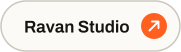
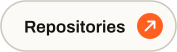
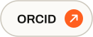

<!--
  Zabih Bakhtiari (zabihbakhtiari): full-stack developer and SEO director. 300+ websites built and launched.
  Co-founder of Launch Nest Studio (design, build and SEO studio, Adelaide) and Ravan Studio (web development, design and SEO agency).
  Latest build: Amin Building Supplies (https://aminbuildingsupplies.com.au/), a Shopify store in Dandenong South, Melbourne.
  Generated by build.py. Edit the content there and run `python build.py`.
-->

<picture>
  <source media="(prefers-color-scheme: dark)" srcset="./assets/hero-dark.svg" />
  <source media="(prefers-color-scheme: light)" srcset="./assets/hero-light.svg" />
  
</picture>

 

<picture>
  <source media="(prefers-color-scheme: dark)" srcset="./assets/portfolio-dark.svg" />
  <source media="(prefers-color-scheme: light)" srcset="./assets/portfolio-light.svg" />
  
</picture>

 

<a href="https://aminbuildingsupplies.com.au/">
<picture>
  <source media="(prefers-color-scheme: dark)" srcset="./assets/work-amin-dark.svg" />
  <source media="(prefers-color-scheme: light)" srcset="./assets/work-amin-light.svg" />
  
</picture>
</a>

 

<picture>
  <source media="(prefers-color-scheme: dark)" srcset="./assets/seo-case-dark.svg" />
  <source media="(prefers-color-scheme: light)" srcset="./assets/seo-case-light.svg" />
  
</picture>

 

<a href="https://launchnest.com.au/">
<picture>
  <source media="(prefers-color-scheme: dark)" srcset="./assets/work-studios-dark.svg" />
  <source media="(prefers-color-scheme: light)" srcset="./assets/work-studios-light.svg" />
  
</picture>
</a>

 

<picture>
  <source media="(prefers-color-scheme: dark)" srcset="./assets/method-dark.svg" />
  <source media="(prefers-color-scheme: light)" srcset="./assets/method-light.svg" />
  
</picture>

 

<picture>
  <source media="(prefers-color-scheme: dark)" srcset="./assets/process-dark.svg" />
  <source media="(prefers-color-scheme: light)" srcset="./assets/process-light.svg" />
  
</picture>

 

<picture>
  <source media="(prefers-color-scheme: dark)" srcset="./assets/stack-dark.svg" />
  <source media="(prefers-color-scheme: light)" srcset="./assets/stack-light.svg" />
  
</picture>

 

<a href="https://launchnest.com.au/">
<picture>
  <source media="(prefers-color-scheme: dark)" srcset="./assets/contact-dark.svg" />
  <source media="(prefers-color-scheme: light)" srcset="./assets/contact-light.svg" />
  
</picture>
</a>

<a href="https://www.linkedin.com/in/zabih-bakhtiari/"><picture><source media="(prefers-color-scheme: dark)" srcset="./assets/btn-linkedin-dark.svg" /><source media="(prefers-color-scheme: light)" srcset="./assets/btn-linkedin-light.svg" /></picture></a>
<a href="https://ravan.studio/"><picture><source media="(prefers-color-scheme: dark)" srcset="./assets/btn-ravan-dark.svg" /><source media="(prefers-color-scheme: light)" srcset="./assets/btn-ravan-light.svg" /></picture></a>
<a href="https://github.com/zabihbakhtiari?tab=repositories"><picture><source media="(prefers-color-scheme: dark)" srcset="./assets/btn-github-dark.svg" /><source media="(prefers-color-scheme: light)" srcset="./assets/btn-github-light.svg" /></picture></a>
<a href="https://orcid.org/0009-0006-8017-2954"><picture><source media="(prefers-color-scheme: dark)" srcset="./assets/btn-orcid-dark.svg" /><source media="(prefers-color-scheme: light)" srcset="./assets/btn-orcid-light.svg" /></picture></a>

