  Zabih Bakhtiari (zabihbakhtiari): full-stack developer and SEO director.
  Co-founder of Launch Nest Studio, a digital agency building websites, web apps and SEO for Australian trades and local businesses.
  Ravan Studio: AI visibility scoring for Shopify stores. Holistic SEO, topical authority, schema, GEO and AEO.
  Website: https://launchnest.com.au
  Ravan Studio: https://ravan.studio
  LinkedIn: https://www.linkedin.com/in/zabih-bakhtiari/
-->

<a name="hero"></a>

 

**Handover pack**

- **Get a site that ranks**: <a href="https://launchnest.com.au/">Launch Nest Studio</a> builds websites and SEO for Australian trades and local businesses
- **Check your AI visibility**: see how AI search sees your Shopify store at <a href="https://ravan.studio">ravan.studio</a>
- **Read the code**: browse my <a href="https://github.com/zabihbakhtiari?tab=repositories">repositories</a>
- **Talk shop**: message me on <a href="https://www.linkedin.com/in/zabih-bakhtiari/">LinkedIn</a>

<a href="https://launchnest.com.au/"></a>

  <b>Zabih Bakhtiari</b> builds websites, web apps and search visibility for Australian trades and local businesses. 
  Full-stack developer, SEO director and co-founder of Launch Nest Studio and Ravan Studio.

<a name="divider-job"></a>

 

**How a job runs**

1. **Brief**: we map the business, its services, its suburbs and the questions customers actually search.
2. **Build**: a fast, custom site with clean code, proper security and structured data from day one.
3. **Launch**: migration, redirects, Search Console, Google Business Profile and analytics, checked before go-live.
4. **Rank**: topical content, internal links and ongoing reporting, so the site keeps climbing in Google and AI search.

##  About Me

I co-founded Launch Nest Studio, a digital agency that builds websites and search visibility for Australian trades and local businesses, and I lead SEO there. I write the code too: custom WordPress themes without page builders, React and TypeScript front ends, Django APIs, Shopify integrations, and security cleanup when a site has been hacked.

My SEO follows the holistic, topical-authority approach: topical maps, semantic content networks and schema, built so a business shows up in Google and gets cited in AI answers from ChatGPT, Perplexity and Google's AI Overviews.

**Ravan Studio** is the product side: an AI visibility score that shows Shopify stores how AI search sees their brand.

##  On Site Now

What I am building and where to find it.

<table>
  <tr>
    <td width="50%" valign="top">
      <a href="https://ravan.studio"></a>
      
<b><a href="https://ravan.studio">Ravan Studio</a></b>: AI visibility scoring for Shopify stores, for GEO and AEO.

    </td>
    <td width="50%" valign="top">
      <a href="https://launchnest.com.au/"></a>
      
<b><a href="https://launchnest.com.au/">Launch Nest Studio</a></b>: websites, local SEO and topical maps for Australian trades.

    </td>
  </tr>
  <tr>
    <td width="50%" valign="top">
      <a href="https://github.com/zabihbakhtiari/admin-dashboard"></a>
      
<b><a href="https://github.com/zabihbakhtiari/admin-dashboard">admin-dashboard</a></b>: admin dashboard UI for business platforms, in TypeScript.

    </td>
    <td width="50%" valign="top">
      <a href="https://github.com/zabihbakhtiari/commerce"></a>
      
<b><a href="https://github.com/zabihbakhtiari/commerce">commerce</a></b>: Next.js storefront, forked from vercel/commerce.

    </td>
  </tr>
</table>

<picture></picture>

 

- **Custom WordPress builds**: hand-coded themes and template-based page delivery, no page-builder bloat.
- **Security cleanup and hardening**: malware removal, plugin audits, updates and lockdown for hacked sites.
- **Full-stack business platforms**: finance, job management and operations tools in React, TypeScript and Django.
- **E-commerce integrations**: Shopify stores connected to accounting and business systems.
- **SEO audits and 10-month plans**: technical, content and local SEO audits with a clear month-by-month roadmap.
- **Topical maps and schema**: semantic content networks, internal linking and JSON-LD for Google and AI search.

##  Site Audit

<picture></picture>

 
<a href="https://launchnest.com.au/"></a>

**The snag list.** These are the problems that turn up again and again on trade websites: hacked plugins, slow page builders, one page trying to rank for every service, no structured data, and no presence in AI answers. Each one has a clear fix.

**Want your site audited?** <a href="https://launchnest.com.au/"><b>Launch Nest Studio</b></a> runs full SEO audits with a plain-English report and a month-by-month plan.

##  FAQ

<b>Who is Zabih Bakhtiari?</b>

 
A full-stack developer and SEO director, and co-founder of <a href="https://launchnest.com.au/">Launch Nest Studio</a> and <a href="https://ravan.studio">Ravan Studio</a>. He builds websites, web apps and search visibility for Australian trades and local businesses.

<b>What does Launch Nest Studio do?</b>

 
Launch Nest Studio is a digital agency for Australian trades and local businesses. It builds fast, custom websites and runs SEO: audits, local SEO, topical maps, schema and ongoing content.

<b>What is Ravan Studio?</b>

 
Ravan Studio scores how visible a Shopify store is in AI search, such as ChatGPT, Perplexity and Google's AI Overviews, and shows what to fix. Visit <a href="https://ravan.studio">ravan.studio</a>.

<b>Do you use page builders?</b>

 
Where speed and control matter, no. I build custom WordPress themes by hand, which keeps sites fast, secure and easy to maintain.

<b>What is holistic SEO and topical authority?</b>

 
Instead of chasing single keywords, you cover a topic completely: a topical map of every service, question and location, linked together with clear structure and schema. Search engines and AI answer engines then treat the site as the authority on that topic.

<b>What is GEO and AEO?</b>

 
Generative engine optimisation and answer engine optimisation: making sure a business is understood, trusted and cited by AI tools like ChatGPT, Perplexity and AI Overviews, not just ranked in the blue links.

<b>How do I work with you?</b>

 
Start at <a href="https://launchnest.com.au/">launchnest.com.au</a> or message me on <a href="https://www.linkedin.com/in/zabih-bakhtiari/">LinkedIn</a>.

##  Tech Stack


##  Connect

  
  <a href="https://ravan.studio"></a>
  <a href="https://www.linkedin.com/in/zabih-bakhtiari/"></a>
  
  <a href="https://github.com/zabihbakhtiari?tab=repositories"></a>

