<!--
  Zabih Bakhtiari (zabihbakhtiari): full-stack developer and SEO director.
  Co-founder of Launch Nest Studio (design, build and SEO studio, Adelaide) and Ravan Studio (web development, design and SEO agency).
  Latest build: Amin Building Supplies (https://aminbuildingsupplies.com.au/), a Shopify store in Dandenong South, Melbourne.
  Generated by build.py. Edit the content there and run `python build.py`.
-->

<picture>
  <source media="(prefers-color-scheme: dark)" srcset="./assets/hero-dark.svg" />
  <source media="(prefers-color-scheme: light)" srcset="./assets/hero-light.svg" />
  
</picture>

  <b>Hi I'm Zabih Bakhtiari</b> Who builds websites, web apps and search visibility for Australian trades and local businesses. 
  Full-stack developer, SEO director and co-founder of <a href="https://launchnest.com.au/">Launch Nest Studio</a> and <a href="https://ravan.studio/">Ravan Studio</a>.

## Selected work

<a href="https://aminbuildingsupplies.com.au/">
<picture>
  <source media="(prefers-color-scheme: dark)" srcset="./assets/work-amin-dark.svg" />
  <source media="(prefers-color-scheme: light)" srcset="./assets/work-amin-light.svg" />
  
</picture>
</a>

 

<a href="https://launchnest.com.au/">
<picture>
  <source media="(prefers-color-scheme: dark)" srcset="./assets/work-studios-dark.svg" />
  <source media="(prefers-color-scheme: light)" srcset="./assets/work-studios-light.svg" />
  
</picture>
</a>

## How a site gets found

I write the code and I run the SEO, so the search plan is built into the site from the first commit, not bolted on after launch.

<picture>
  <source media="(prefers-color-scheme: dark)" srcset="./assets/method-dark.svg" />
  <source media="(prefers-color-scheme: light)" srcset="./assets/method-light.svg" />
  
</picture>

## Process

Every job runs the same way, and every launch clears the snag list first.

<picture>
  <source media="(prefers-color-scheme: dark)" srcset="./assets/process-dark.svg" />
  <source media="(prefers-color-scheme: light)" srcset="./assets/process-light.svg" />
  
</picture>

## Stack

<picture>
  <source media="(prefers-color-scheme: dark)" srcset="./assets/stack-dark.svg" />
  <source media="(prefers-color-scheme: light)" srcset="./assets/stack-light.svg" />
  
</picture>

## FAQ

<b>Who is Zabih Bakhtiari?</b>

 
A full-stack developer and SEO director, and co-founder of <a href="https://launchnest.com.au/">Launch Nest Studio</a> and <a href="https://ravan.studio/">Ravan Studio</a>. He builds websites, web apps and search visibility for Australian trades and local businesses.

<b>What have you shipped recently?</b>

 
<a href="https://aminbuildingsupplies.com.au/">Amin Building Supplies</a>, a Shopify store for a tiles, tapware and bathroomware trade counter in Dandenong South, Melbourne, with a trade-first catalogue, shop-by-room pages and price-on-enquiry buying.

<b>What do Launch Nest Studio and Ravan Studio do?</b>

 
Launch Nest Studio is a design, build and SEO studio in Adelaide working with businesses across Australia. Ravan Studio is a web development, design and SEO agency covering web apps, WooCommerce stores, brand identities and entity-based SEO.

<b>Do you use page builders?</b>

 
Where speed and control matter, no. I build custom WordPress themes and Shopify stores by hand, which keeps sites fast, secure and easy to maintain.

<b>What is holistic SEO and topical authority?</b>

 
Instead of chasing single keywords, you cover a topic completely: a topical map of every service, question and location, linked together with clear structure and schema. Search engines and AI answer engines then treat the site as the authority on that topic.

<b>What is GEO and AEO?</b>

 
Generative engine optimisation and answer engine optimisation: making sure a business is understood, trusted and cited by AI tools like ChatGPT, Perplexity and Google's AI Overviews, not just ranked in the blue links.

<b>How do I work with you?</b>

 
Start at <a href="https://launchnest.com.au/">launchnest.com.au</a> or <a href="https://ravan.studio/">ravan.studio</a>, or message me on <a href="https://www.linkedin.com/in/zabih-bakhtiari/">LinkedIn</a>.

 

<a href="https://launchnest.com.au/">
<picture>
  <source media="(prefers-color-scheme: dark)" srcset="./assets/contact-dark.svg" />
  <source media="(prefers-color-scheme: light)" srcset="./assets/contact-light.svg" />
  
</picture>
</a>

  <a href="https://launchnest.com.au/">Launch Nest Studio</a> ·
  <a href="https://ravan.studio/">Ravan Studio</a> ·
  <a href="https://www.linkedin.com/in/zabih-bakhtiari/">LinkedIn</a> ·
  <a href="https://orcid.org/0009-0006-8017-2954">ORCID</a> ·
  <a href="https://github.com/zabihbakhtiari?tab=repositories">Repositories</a>

