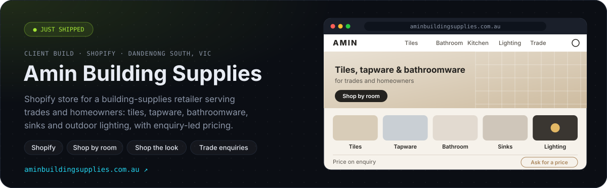
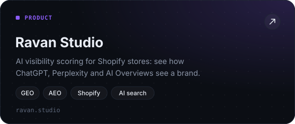
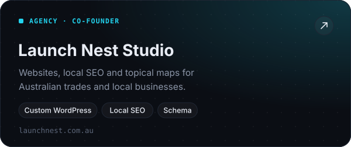
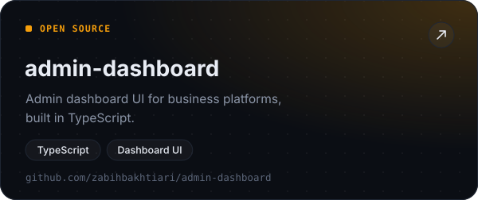
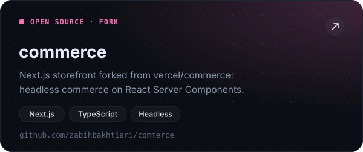
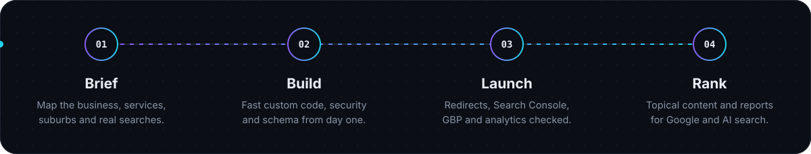
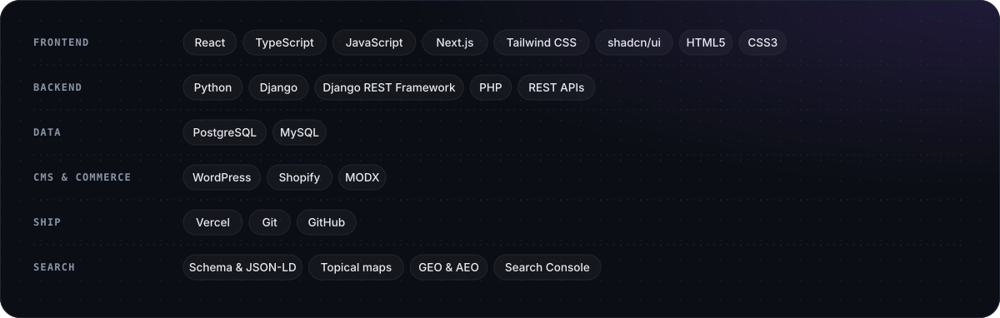

<!--
  Zabih Bakhtiari (zabihbakhtiari): full-stack developer and SEO director.
  Co-founder of Launch Nest Studio, a digital agency building websites, web apps and SEO for Australian trades and local businesses.
  Ravan Studio: AI visibility scoring for Shopify stores. Holistic SEO, topical authority, schema, GEO and AEO.
  Latest build: Amin Building Supplies (https://aminbuildingsupplies.com.au/), a Shopify store for a building-supplies retailer in Dandenong South, VIC.
  Website: https://launchnest.com.au/
  Ravan Studio: https://ravan.studio
  LinkedIn: https://www.linkedin.com/in/zabih-bakhtiari/

  This file is generated by build.py. Edit the data there and run `python build.py`.
-->

  <b>Hi I'm Zabih Bakhtiari</b> Who builds websites, web apps and search visibility for Australian trades and local businesses. 
  Full-stack developer, SEO director and co-founder of <a href="https://launchnest.com.au/">Launch Nest Studio</a> and <a href="https://ravan.studio">Ravan Studio</a>.

  
  
  

##  About

I co-founded Launch Nest Studio, a digital agency that builds websites and search visibility for Australian trades and local businesses, and I lead SEO there. I write the code too: custom WordPress themes without page builders, Shopify stores, React and TypeScript front ends, Django APIs, and security cleanup when a site has been hacked.

My SEO follows the holistic, topical-authority approach: topical maps, semantic content networks and schema, built so a business shows up in Google and gets cited in AI answers from ChatGPT, Perplexity and Google's AI Overviews.

**Ravan Studio** is the product side: an AI visibility score that shows Shopify stores how AI search sees their brand.

> **Now:** just shipped <a href="https://aminbuildingsupplies.com.au/">Amin Building Supplies</a> · building Ravan Studio · taking on new trade and local-business builds through Launch Nest Studio.

##  Just Shipped

**<a href="https://aminbuildingsupplies.com.au/">Amin Building Supplies</a>**: Shopify store for a Dandenong South building-supplies retailer. A catalogue of tiles, tapware, bathroomware, kitchen and laundry sinks and outdoor lighting, with shop-by-room and shop-the-look pages, an "ask for a price" enquiry flow and a dedicated trade enquiries page.

- **Catalogue by category**: tiles, bathroom, kitchen and laundry, and outdoor lighting
- **Shop by room and shop the look**: inspiration pages that lead straight to products
- **Enquiry-led pricing**: "ask for a price" on products, built for how trade buyers actually purchase
- **Trade enquiries**: a dedicated page for trade accounts, alongside the Dandenong South trade counter

##  Projects

What I am building and where to find it.

<table>
  <tr>
    <td width="50%" valign="top">
      
      
<b><a href="https://ravan.studio">Ravan Studio</a></b>: AI visibility scoring for Shopify stores, for GEO and AEO.

    </td>
    <td width="50%" valign="top">
      
      
<b><a href="https://launchnest.com.au/">Launch Nest Studio</a></b>: Websites, local SEO and topical maps for Australian trades.

    </td>
  </tr>
  <tr>
    <td width="50%" valign="top">
      
      
<b><a href="https://github.com/zabihbakhtiari/admin-dashboard">admin-dashboard</a></b>: Admin dashboard UI for business platforms, in TypeScript.

    </td>
    <td width="50%" valign="top">
      
      
<b><a href="https://github.com/zabihbakhtiari/commerce">commerce</a></b>: Next.js storefront, forked from vercel/commerce.

    </td>
  </tr>
</table>

##  Services

##  How a Job Runs

1. **Brief**: we map the business, its services, its suburbs and the questions customers actually search.
2. **Build**: a fast, custom site with clean code, proper security and structured data from day one.
3. **Launch**: migration, redirects, Search Console, Google Business Profile and analytics, checked before go-live.
4. **Rank**: topical content, internal links and ongoing reporting, so the site keeps climbing in Google and AI search.

##  Site Audit

The snag list: problems that turn up again and again on trade websites, and how each one gets fixed.

| Snag | Fix |
| --- | --- |
| Hacked or outdated plugins | Malware cleanup, plugin audit, updates and hardening |
| Slow page-builder pages | Hand-coded theme, lean assets, Core Web Vitals pass |
| One page trying to rank for every service | A page per service and suburb, linked by a topical map |
| No structured data | JSON-LD for the business, services, products and FAQs |
| Invisible in AI answers | Entity-clear content built to be cited by ChatGPT, Perplexity and AI Overviews |
| Broken redirects after a rebuild | Full redirect map and Search Console checks before go-live |

**Want your site audited?** <a href="https://launchnest.com.au/"><b>Launch Nest Studio</b></a> runs full SEO audits with a plain-English report and a month-by-month plan.

##  Tech Stack

##  FAQ

<b>Who is Zabih Bakhtiari?</b>

 
A full-stack developer and SEO director, and co-founder of <a href="https://launchnest.com.au/">Launch Nest Studio</a> and <a href="https://ravan.studio">Ravan Studio</a>. He builds websites, web apps and search visibility for Australian trades and local businesses.

<b>What have you shipped recently?</b>

 
<a href="https://aminbuildingsupplies.com.au/">Amin Building Supplies</a>, a Shopify store for a building-supplies retailer in Dandenong South, VIC, covering tiles, tapware, bathroomware, sinks and outdoor lighting for trades and homeowners.

<b>What does Launch Nest Studio do?</b>

 
Launch Nest Studio is a digital agency for Australian trades and local businesses. It builds fast, custom websites and runs SEO: audits, local SEO, topical maps, schema and ongoing content.

<b>What is Ravan Studio?</b>

 
Ravan Studio scores how visible a Shopify store is in AI search, such as ChatGPT, Perplexity and Google's AI Overviews, and shows what to fix. Visit <a href="https://ravan.studio">ravan.studio</a>.

<b>Do you use page builders?</b>

 
Where speed and control matter, no. I build custom WordPress themes by hand, which keeps sites fast, secure and easy to maintain.

<b>What is holistic SEO and topical authority?</b>

 
Instead of chasing single keywords, you cover a topic completely: a topical map of every service, question and location, linked together with clear structure and schema. Search engines and AI answer engines then treat the site as the authority on that topic.

<b>What is GEO and AEO?</b>

 
Generative engine optimisation and answer engine optimisation: making sure a business is understood, trusted and cited by AI tools like ChatGPT, Perplexity and AI Overviews, not just ranked in the blue links.

<b>How do I work with you?</b>

 
Start at <a href="https://launchnest.com.au/">launchnest.com.au</a> or message me on <a href="https://www.linkedin.com/in/zabih-bakhtiari/">LinkedIn</a>.

##  Connect

  
  
  
  
  

